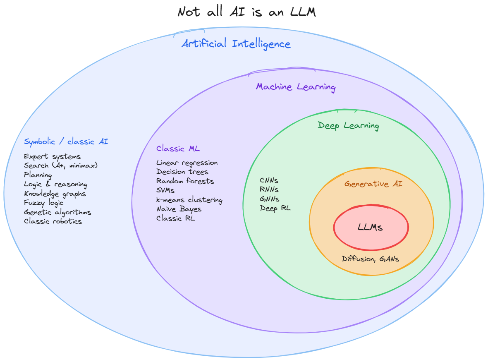
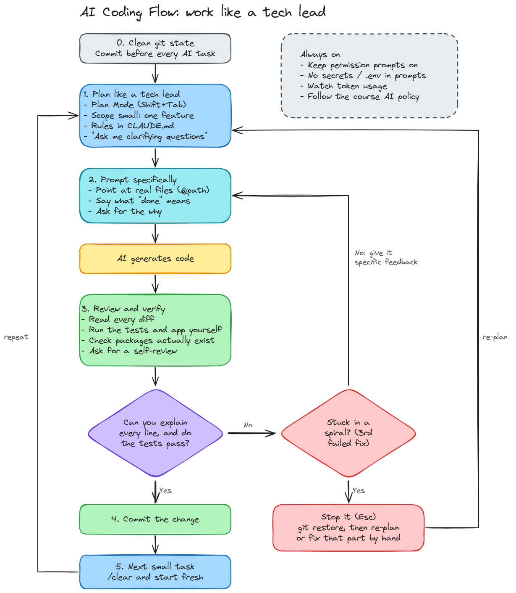

# Using Artificial Intelligence in Software Development - Discussion

In this example we're mainly going to have a discussion about artificial intelligence, large language models, and the future of software development.

We'll have a long discussion about pros and cons, how to prevent cognitive surrender, and how to use these tools effectively in software development.

## Tools we'll use and a list of popular software-focused tools

### Tools we'll use
- **[Claude Code](https://www.anthropic.com/product/claude)** - Claude is a large language model developed by Anthropic.
  - **We'll be using this in our class and you can use this for your final project.**
  - We'll be using this to generate code directly in our IDE.

- **GitHub Copilot**
  - This already has a lot of tooling built into VS Code but might yield slightly different results than Claude Code. You can use this in your final project as well.

### Popular tools
- **[Codex](https://openai.com/blog/openai-codex)** - Codex is a tool developed by OpenAI that allows you to use large language models in your IDE and has a lot of tooling built in for software development.
  - This is a popular tool as well, with much of the same tooling as the other tools above.
  - This uses the same model as **ChatGPT** and is also used in GitHub Copilot.
- **[Gemini](https://gemini.google/)** - Gemini is a large language model developed by Google.
  - This is a popular tool as well, with much of the same tooling as the other tools above.

- **[Cursor](https://www.cursordev.com/)** - Cursor is a platform that allows you to use large language models in your IDE and has a lot of tooling built in for software development.

---

## What we'll cover in this discussion

- **1 - Artificial Intelligence vs. Large Language Models**
- **2 - How the Nature of Work in Software Development is Changing**
- **3 - Pros and Cons of using Large Language Models in Software Development (especially as a junior developer)**
- **4 - How to prevent cognitive surrender and over-reliance on AI tools**
- **5 - Identifying issues and what to generally look out for when using AI tools in software development, and Common Bug Patterns**
- **6 - Tips for using AI tools effectively in software development**

---

## 1 - Artificial Intelligence vs. Large Language Models

### Not All Artificial Intelligence Is the Same, and It's Not All Just Large Language Models

Over the years the term Artificial Intelligence has been used to describe different types of software and tools.

Let's take a look at the different types of AI and where Large Language Models fit in.

**IMPORTANT NOTE:** You'll learn more about these AI tools in the next course.

#### Symbolic / classic AI (not machine learning)
These systems run on hand-written rules, logic, or search. They don’t learn from data.

Expert systems (if-then rule engines, e.g. medical diagnosis or tax software)
Search algorithms (A* pathfinding in GPS, minimax in chess engines)
Automated planning and scheduling
Logic and reasoning systems (theorem provers, Prolog)
Knowledge graphs and ontologies
Fuzzy logic (thermostats, washing machines, camera autofocus)
Genetic / evolutionary algorithms
Classic robotics and control systems

#### Machine Learning
These systems learn patterns from data instead of following hand-written rules.

Classic ML: linear and logistic regression, decision trees, random forests, gradient boosting, support vector machines, k-means clustering, naive Bayes (spam filters), k-nearest neighbours, and classic reinforcement learning

#### Deep Learning
This is a subset of ML that uses multi-layer neural networks.

CNNs (Convolutional Neural Networks) for images (face unlock, medical imaging)
RNNs and LSTMs (Recurrent Neural Networks and Long Short-Term Memory networks) for sequences (older speech recognition and translation)
Graph neural networks (drug discovery, recommendations)
Deep reinforcement learning (AlphaGo, robot control)
  - Note: this one was pioneered by Richard Sutton, who's a fellow Edmontonian!

####  Generative AI
This is a subset of deep learning that creates new content.

Diffusion models (image and video generators)
GANs (deepfakes, image synthesis)
Audio and music generation

#### Large Language Models (LLMs)
These are generative models trained on huge amounts of text, such as Claude, GPT, Gemini, and Llama. They’re one slice of generative AI, which is one slice of deep learning, which is one slice of ML, which is one slice of AI.

The diagram simplifies two things. Generative AI is drawn entirely inside deep learning, but a few older generative methods, like Markov chains and hidden Markov models, aren’t deep learning. Also, some fields such as computer vision, natural language processing, and robotics cut across every layer, so they’re areas of application rather than separate circles.

### Discussion Questions
- Which of the AI types in the diagram have you already used today without noticing (spam filter, GPS, face unlock)?
- If an LLM only predicts plausible text, what does that tell you about how much to trust its code?
- Why do you think "AI" has become shorthand for "LLM" in the news?

---

## 2 - How the Nature of Work in Software Development is Changing

The nature of the work in software development is changing rapidly with the introduction of large language models and other AI tools.

### What it used to be like

In the past, software development was very manual, which is what we're doing in this course. You write code, you test it, you debug it, and you deploy it.
- This is still important to learn and understand because you need to understand how to write code and how to debug it in order to understand what the AI tools are doing under the hood.
- You need to understand "what good code looks like" in order to be able to identify issues with the code that the AI tools generate for you.

The breakdown of the job of a software developer used to be something like this:
- 30% - planning and design
- 50% - writing code, testing and debugging
- 20% - reviewing code, deploying code, and maintaining code

### What it is now and beyond

With the introduction of large language models and other AI tools, the job is basically like becoming a manager/technical lead of a bunch of junior developers (where the AI tools are the junior developers). You need to be able to manage and lead these AI tools effectively in order to get the best results.
- AI, like a junior dev, is really good at specific tasks but not so great at some other tasks.
- Like a good technical lead, you need to be able to make sure that AI tools are:
  - Doing the right tasks, and that the tasks are well defined and scoped correctly
  - Using the architecture and design patterns that you've defined for your project and not straying from the path.

The breakdown of the job of a software developer now looks more like this:
- 50% - planning and design
- 5% - writing code, testing and debugging (if you're lucky)
- 45% - reviewing code, deploying code, and maintaining code

***Am I still going to have a job as a software dev?***
- Yes, because people will still need folks to manage computers and the AI tools.
- It's a great opportunity for you folks to make your own company and build your own products, or lead companies (that haven't bought in) into the future of software.
- Using AI is a bit like CGI in the movie industry.
  - When it looks bad, it's obvious and distracting and people will notice and complain.
  - When it looks good, people won't notice and will just enjoy the movie.
  - Note: no one wants to watch a movie with bad CGI, and no one wants to use software with bad code, or AI slop.

***Disclaimer:*** This course is opinionated against spinning off agents and not reviewing the code that AI tools generate. We'll discuss this more in the pros and cons section.

### Discussion Questions
- What skills does a good tech lead have that a good coder might not? How do you build them as a student?
- The CGI analogy says good AI use goes unnoticed. Can you think of software that feels like "AI slop"? What gave it away?

## 3 - Pros and Cons of using Large Language Models in Software Development (especially as a junior developer)

### Pros of using Large Language Models in Software Development

#### Fast and Complex Code Generation

1. It's really fast at generating code if you know what you're trying to generate.
2. It generates code at a pretty complex level.
   1. We'll revisit this in the cons section as well, because this might lead to skill atrophy if you don't review the code and understand it.
3. Really good for ideation, exploration, and building MVPs
   1. Sometimes you just want to get a prototype out there and see if it works, and then you can iterate on it.

#### Debugging and Understanding Code

1. Really good at processing large amounts of data
2. Really good at semantic search in the codebase.
   1. Not only can it search for exact matches, but it can also search by vague intent.
3. It's really effective at debugging code.
   1. It's been trained on the world's software questions and can read error output, which is really great and keeps you unblocked.
4. Really great at explaining what a part of the code (or legacy code) is doing at a specific point in the project.
   1. Understanding existing code is a really important skill to have to be able to contribute to a project effectively.
5. It's good at remembering context, and things that you might forget about the codebase.
   1. You can get summaries of the codebase and some decisions that were made in the past and why they were made.

#### Testing and Documentation
1. It's great at writing tests and generating test cases for your code.
   1. It's a really good idea to leverage this to make sure that you have great backend tests. Note: remember we've discussed the fickleness of integration tests and how they can be brittle and break easily. So make sure you use it to generate unit tests as well.
2. Documentation generation is pretty good with large language models.
    1. This is a great way to make sure that your code is well documented and that you have good documentation for your project. In the past this was a really time-consuming task, and now you can leverage AI to do this for you.

### Cons of using Large Language Models in Software Development

#### Skill Atrophy, Lack of Understanding, and Cognitive Surrender

1. If you rely on these tools too much and don't review the code that they generate, you might not understand the code you're shipping, and you might not be able to improve your skills as a software developer.
  - LLMs introduce bugs and architectural issues that might lead to larger issues.
    - In the past, these were usually obvious when the decisions were made by humans, but this is not the case with AI tools. The architectural decisions that might lead to issues are more subtle and less obvious, and require more diligence to fix.
2. *Cognitive Surrender* is the lure of giving up your own judgment when using AI tools.
  - We'll discuss this in Section 4.
  - *Cognitive offloading* is related, where you completely opt out of the decision-making process, which is not a good thing.

#### Change in the Nature of the Job and General Enjoyment in Software Development

1. You're going to spend most of your time reviewing code and reading output from the LLM, and generally it's not as fun as writing the code yourself. This is a personal opinion and some people might enjoy this more than others.
2. The cognitive load of reviewing code and making sure that the code is correct and that the AI tools are doing what you want them to do can be really high and can be stressful at times.
  1. Trying to manage everything that is going on and give a reasonable review to ensure that the code is doing what you want is much more difficult with AI. It's like studying all the time for a final exam.
  2. Doing PR reviews all day is just not as fun.
3. Sometimes this leads to the "Lifeguard Problem", where you're diligently watching something and rarely have to intervene, but when you do, it's critical.

#### Effectiveness of the Tools and Code Quality from Large Language Models

1. It can be really costly to use these tools if you're not careful and don't have a good plan for how to use them effectively.
2. AI hallucinations are a real thing. This is when the AI generates code that looks correct but is actually incorrect or doesn't do what you want it to do.
  1. It might go off on tangents and generate code that is not relevant to what you want it to do. You need to be able to identify this and remove/fix it.
3. It's hard to know how much faster a task actually is than if you'd coded it yourself, because AI has become so ubiquitous.
4. It can break things without you realizing, and do things without your consent.
  1. It can delete a production database. [Read more about this here](https://readwise.io/reader/shared/01kqsye7v4p7j0jz3v992fgta8/)
  2. It can delete files off your computer that you didn't want deleted.
  3. It won't always follow strict directions, and sometimes will break out of the harness that you think it's in. [Like the Hugging Face hack](https://techcrunch.com/2026/07/20/hugging-face-confirms-breach-affected-internal-datasets-and-credentials-urges-users-to-take-action/)
5. Filling up your context window (the more files you add) makes the model less accurate.
  1. As you fill a context window, the model’s attention gets spread across more and more text, so the relevant facts get harder to pick out. Information in the middle tends to get overlooked, similar or conflicting details get mixed up, and in long sessions the model’s own earlier mistakes pile up and get treated as fact. When it can’t reliably find the right evidence, it falls back on plausible-sounding guesses, which are hallucinations.

### Discussion Questions
- Which pro would help you most this term, and which con worries you most?
- How would you measure whether AI actually made you faster on a task?

## 4 - How to prevent cognitive surrender and over-reliance on AI tools

### What is Cognitive Offloading?

This is when you decide (consciously or not) to no longer review what the AI is doing. This isn't good for many reasons, some of which we've already mentioned.

### What causes Cognitive Offloading?

Many times this is caused by exhaustion, burnout, or decision fatigue (or even laziness, unfortunately).

At the current pace of software development (especially with AI), it's mentally exhausting, and after a certain point it can be really difficult to stay focused.

### Tips to prevent Cognitive Offloading

1. Take Breaks
   1. Walk away from your computer, go outside, and limit your screen time.
2. Limit how much you do in a day
   1. Manage your time in a day so that you do other tasks, not just development.
      1. Planning with other teams
      2. Sharing ideas with other teams
      3. Catching up on communication that isn't development-related
3. Pomodoro Timers (or chunk your coding into timed segments)
   1. This is a technique where you work for a set amount of time (usually 25 minutes) and then take a break (usually 5 minutes). This helps to keep your mind fresh and focused.

### You can still practice writing code by hand

To master software development, or to get better at a specific task, learn to write the code by hand *BEFORE* you try the task with AI.

The more you learn about the techniques and concepts by hand, the more comfortable you'll be building quickly with AI in the future.

### Discussion Questions
- When is offloading a task to AI healthy, and when does it turn into surrender? Where is the line?
- Have you ever accepted an answer (AI or Stack Overflow) without understanding it? What happened?
- What personal rules could you set to make sure you keep learning while using AI?
- Should courses like this one ban, allow, or require AI? Why?

## 5 - Identifying issues and what to generally look out for when using AI tools in software development and Common Bug Patterns

In the upcoming classes we're going to be doing a lot of coding with AI. Below we're going to talk about some issues to look out for when using AI tools in software development.

- **Divergence from the Plan, or Lack of Divergence from the Plan**
  - The AI tool might not follow the plan that you have in mind and might generate code that is not relevant to what you want to do.
  - On the other hand, it might be too rigid and follow the plan too closely, even for a decision that you might want to change.
- **Weird Architectural Decisions**
  - The AI tool might generate code that doesn't follow the architecture that you have in mind and might generate code that is not relevant to what you want to do.
- **Too Much Code Generation**
  - Sometimes it over-engineers the solution and generates too much code that is not relevant to what you want to do.
  - Hesitancy to refactor old code or delete code.
    - It might not modify code that is already there, and instead just generate new code that repeats code that's already there.
    - This creates really intricate, brittle, convoluted solutions to problems that could be solved more simply.
- **Tech Debt**
  - The definition of tech debt is when you take a shortcut in the code that you know is not the best solution but you do it anyway because it's faster.
  - The AI tool might generate code that is not the best solution and take shortcuts that might lead to tech debt in the future. Especially if you're getting it to generate a lot of code and not reviewing it.
- **Dodging your rules, Quiet Decision Making, and Lack of Transparency**
  - The AI tool might generate code that doesn't follow the rules that you have in mind and might generate code that is not relevant to what you want to do.
  - It might also make decisions that aren't transparent, so you might not know why it made a certain decision.
- **Token Drains**
  - Sometimes AI might start a task and just eat tokens and not actually do anything useful. This is a waste of time and resources and you need to be able to identify this and stop it.
- **Hallucinations**
  - Sometimes the AI tool might generate code that is not relevant to what you want to do and might generate code that is not correct. This is a waste of time and resources and you need to be able to identify this and stop it.
- **Plan Inconsistency**
  - As you develop with AI tools, you create a plan for the AI to implement. Sometimes, for no apparent reason, the AI might diverge from your plan and affect the code in a major way.
  - It might also ignore rules that you have set up for it (more on rules in the next lecture on implementation).
- **Confusion Spirals**
  - Generative AI sometimes goes really deep on a solution that isn't correct, and it might continue down this wrong path without stepping back to evaluate whether a different approach would be better. This is a waste of time and resources and you need to be able to identify this and stop it.

### Discussion Questions
- Which pattern would be hardest to catch in a code review, and why?
- Is AI-generated tech debt worse than human tech debt, or just faster to pile up?

## 6 - Tips for using AI tools effectively in software development

We're going to implement some code with AI in future lectures.

We'll be using Claude Code to do this. The tips below are grouped by workflow. Think of them as how a good tech lead delegates work to a junior developer.

### Here's the flow of using AI tools in software development

### Before you prompt: plan like a tech lead
- **Plan first, code second.**
  - Use Plan Mode (`Shift+Tab` in Claude Code), ask for a plan, then read and edit the plan *before* any code is written.
  - Fixing a plan costs much less than fixing a diff.
- **Scope small.**
  - Ask for one feature, endpoint or component at a time, e.g. "add the `PATCH /api/tasks/<id>/` endpoint and its tests", not "build the app".
- **Give it your rules.**
  - Put your project conventions in a `CLAUDE.md` file: folder layout, "use DRF ViewSets", "use useState, no form libraries", how to run tests.
  - Claude Code reads this file every session, so you don't have to repeat yourself.
- **Have it interview you.**
  - Try "Ask me clarifying questions before you start." This brings hidden assumptions out early.

### While prompting: be specific
- **Point it at real files.**
  - Reference files with `@path/to/file` and say which existing pattern to copy, e.g. "follow how `serializers.py` does `TaskSerializer`".
- **Say what "done" means.**
  - Give acceptance criteria and the command to run the tests (`python manage.py test`, `npm run test`).
- **Ask for the why.**
  - "Explain the change and any alternatives you rejected." This works against the quiet decision-making from Section 5.
- **Use it to learn, not just to produce.**
  - Ask it to explain a concept or review *your* code instead of writing it for you (see Section 4).

### After it generates: review and verify
- **Read every diff.**
  - Treat it like a pull request from a junior developer. If you can't explain a line, don't commit it.
- **Run the tests and the app yourself.**
  - When the AI says "tests pass", that's a claim. Check it.
- **Check that every package and API it uses actually exists.**
  - AI tools sometimes invent package names, and attackers publish malicious packages under those names. Check versions against `requirements.txt` / `package.json`.
- **Ask for a self-review.**
  - e.g. "Review this diff for bugs and anything that strays from CLAUDE.md." Use this as well as your own review, not instead of it.

### Session hygiene
- **Commit before every AI task.**
  - Git is your undo button: use `git diff` to review the change and `git restore` to throw it away.
- **Start fresh often.**
  - Use `/clear` between unrelated tasks and `/compact` in long sessions. A bloated context window leads to hallucinations and confusion spirals (Sections 3 and 5).
- **Stop spirals early.**
  - If it's on its third failed fix, stop it (`Esc`), restate the problem, or fix that part by hand.
- **Watch the cost.**
  - Keep an eye on token usage, and don't let a vague prompt run for a long time.

### Safety
- **Keep the permission prompts on.**
  - Don't auto-approve commands you haven't read. Never point it at production data or credentials.
- **Keep secrets out.**
  - Don't paste `.env` values or API keys into prompts.
- **Follow the course AI policy** for the final project, and be ready to explain any code you submit.

### Discussion Questions
- How much autonomy (permissions) are you comfortable giving an AI tool, and what would change your mind?

---

**In Example 16 we'll put these tips into practice by building a final-project feature with Claude Code.**
